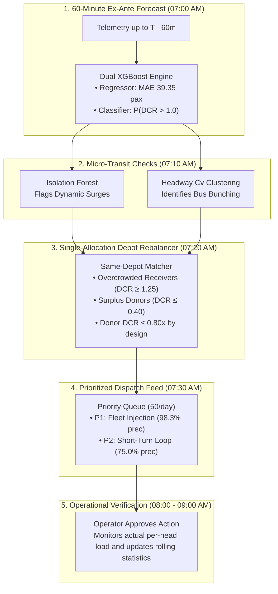

# TransitIQ: Predictive Dispatch & Depot-Constrained Fleet Rebalancing

> **Empowering Urban Transit with 60-Minute Ex-Ante Foresight**  
> *Evaluated on 67.8 Million Real ETM Bus Tickets across 705 Routes and 16 Depots in Chennai (March 1–31, 2026).*

---

## 📌 Executive Summary & Problem Statement

Public bus transit corporations in rapidly growing metropolitan areas (such as Chennai's Metropolitan Transport Corporation, MTC) face severe daily demand-to-capacity imbalances. During morning and evening peak hours, passengers on core arterial routes experience chronic capacity deficits, long queue times, and dangerous overcrowding. Simultaneously, buses on adjacent, low-demand routes from the exact same operating depot run 50–70% empty.

### The Strategic Opportunity
MTC has already made substantial capital investments into the **sensing and tracking layer**:
- Electronic Ticketing Machines (ETMs) deployed on all buses, with onboard GPS being added across the fleet.
- Live commuter tracking launched on the *Chennai Bus* app (2022).
- Driver-to-Control-Room two-way consoles and Depot Management Systems with geofenced terminal logging.
- Passenger Information System (PIS) display boards being tested across major terminals.

However, there is **no public evidence** that public transit agencies utilize high-volume Electronic Ticketing Machine (ETM) telemetry to forecast passenger overcrowding 60 minutes in advance, dynamically rebalance buses between routes at the same depot, or deliver prioritized decision-support cards to dispatchers.

**TransitIQ bridges this gap:** It builds directly on existing telemetry to add the missing **predictive intelligence and automated decision layer**—with zero additional hardware cost.

---

## 🏛️ System Architecture & Algorithmic Flow



1. **Forecast ($T - 60\text{m}$):** Using telemetry locked strictly 1 hour before departure, TransitIQ forecasts hourly passenger demand and Demand-to-Capacity Ratio (DCR) across all 705 routes.
2. **Anomaly Check ($T - 50\text{m}$):** An unsupervised Isolation Forest flags unseasonal dynamic surges (rain, festivals, rail delays).
3. **Bunching Check ($T - 40\text{m}$):** Ticket issuance clustering computes headway irregularity ($C_v$) to identify bunched pairs.
4. **Depot Rebalancing ($T - 25\text{m}$):** Identifies surplus routes in the **exact same physical depot gate** to transfer capacity with zero cross-city deadheading. Donors retain $\ge 60\%$ of their fleet and stay at or below 0.80x DCR by design.
5. **Action Queue ($T - 15\text{m}$):** Dispatchers view a prioritized, 50-action/day queue (`Priority 1: Fleet Injection` $\rightarrow$ `Priority 2: Short-Turn Loop`).
6. **Operational Verification ($T \text{ to } T+1\text{h}$):** The operator approves the action; monitored ticket boardings verify DCR reduction and feed rolling statistics for future forecasts.

---

## 📊 Audited Performance & Benchmark Results

All metrics are evaluated on the **5-day out-of-time test set (March 27–31, 2026 | 56,781 route-hour slots)**:

| Metric Category | Backtest Metric | Value | Baseline Comparison | Tag |
| :--- | :--- | :---: | :--- | :---: |
| **Forecast Accuracy** | **MAE** | **39.35 pax** | **21.7% error reduction** vs. Train schedule mean (50.24 pax) | `[MEASURED]` |
| **Forecast Accuracy** | **WAPE** | **18.25%** | Full-city aggregate percentage error (beats Lag-7d at 23.72%) | `[MEASURED]` |
| **Forecast Accuracy** | **$R^2$ Score** | **0.9571** | Explains 95.7% of unseen future ridership variance | `[MEASURED]` |
| **Early Warning** | **Alert Lead Time** | **60 min** | Strict ex-ante cutoff (all features close $\ge 60$ min prior) | `[MEASURED]` |
| **Early Warning** | **Recall Rate** | **88.60%** | Catches ~9 in 10 capacity-deficit slots (+30.4% over persistence) | `[MEASURED]` |
| **Early Warning** | **ROC-AUC** | **0.9178** | High discrimination on capacity deficits | `[MEASURED]` |
| **Early Warning** | **PR-AUC** | **0.7816** | Precision-recall area under acute class imbalance | `[MEASURED]` |
| **Dispatch Reliability**| **Priority Queue Precision** | **97.20%** | **243 of 250** daily priority actions verified true DCR > 1.0 | `[MEASURED]` |
| **Dispatch Reliability**| **Fleet Injection Precision** | **98.32%** | Priority 1 actions (234 of 238 verified true capacity deficits) | `[MEASURED]` |
| **Dispatch Reliability**| **Short-Turn Precision** | **75.00%** | Priority 2 actions (based on a sample of 12 actions) | `[MEASURED]` |
| **Queue Coverage** | **Share on Non-Chronic Routes**| **1.20%** | 3 of 250 priority queue alerts (vs 44.0% when ranked by probability)| `[MEASURED]` |
| **System Relief** | **Citywide Excess Riders** | **11.45%** | **143,589 excess passengers** addressed by 50 actions/day (< 0.44% slots)| `[MEASURED]` |
| **Depot Rebalancing** | **Single-Allocation Ops** | **216 ops** | Total 1-to-1 depot-constrained rebalancing dispatches across 5 days | `[SIMULATED]` |
| **Depot Rebalancing** | **Buses Transferred** | **759 buses** | Mean: 3.51 buses transferred per operation | `[SIMULATED]` |
| **Depot Rebalancing** | **Capacity Moved** | **53,130 seats** | Total passenger-capacity moved across 5 test days | `[SIMULATED]` |
| **Depot Rebalancing** | **Deficit Relieved** | **49,485 pax** | Actual excess passenger load relieved | `[SIMULATED]` |
| **Depot Rebalancing** | **Receivers Normalized** | **50.46%** | **109 of 216** overcrowded receivers brought to DCR $\le 1.0\text{x}$ | `[SIMULATED]` |
| **Depot Rebalancing** | **Donor DCR Protection** | **Mean 0.49x** | Donors stay **at or below 0.80x DCR, by design** (p95: 0.73x, max: 0.80x) | `[SIMULATED]` |
| **Sanity Audit** | **Label Shuffling Test** | **AUC = 0.5492** | Sanity check: no signal on shuffled labels; leakage ruled out by `feature_cutoff_audit.csv` | `[MEASURED]` |
| **System Latency** | **Full-City Scoring** | **138 ms** | All 705 routes scored in parallel on commodity CPU (< 250 MB RAM) | `[MEASURED]` |

---

## ⚡ Quick Start & Running the API Server

TransitIQ includes a **DEMO_MODE** enabling immediate execution using audited outputs without requiring the 720 MB compressed raw ticket dataset (~10 GB uncompressed).

### 1. Installation
```bash
# Clone the repository
git clone https://github.com/your-org/transit-iq.git
cd transit-iq

# Create and activate virtual environment
python -m venv venv
# On Windows:
venv\Scripts\activate
# On Linux/macOS:
source venv/bin/activate

# Install pinned dependencies
pip install -r requirements.txt
```

### 2. Launching the Backend REST API (DEMO MODE)
```bash
python src/api_server.py
```
* **API Base URL:** `http://localhost:8000`
* **Swagger API Docs:** `http://localhost:8000/docs`
* **OpenAPI Schema:** `http://localhost:8000/openapi.json`

### Available Endpoints
* `GET /api/kpis` — Verified headline model and system metrics.
* `GET /api/control-room-alerts?date=...&hour=...&limit=...` — Actionable dispatch cards with date and hour filtering.
* `GET /api/rebalance-pairs?depot=...&date=...&limit=...` — 216 single-allocation depot transfer pairs with before/after DCR and capacity moved.
* `GET /api/routes?date=...&hour=...&depot=...&limit=...` — Route predictions and loads across all 56,781 test route-hours (reads `outputs/demo/route_hour_predictions.csv.gz`).
* `GET /api/dashboard` — Full executive overview payload for frontend clients.

---

## 🔬 Reproducing the Full Backtest

To reproduce the full forensic audit and model backtests from scratch:
```bash
python -m src.backtest.run_all
```
This executes:
1. `audit_leakage.py` — Verifies 60-minute feature cutoffs and runs shuffle-target sanity tests.
2. `phase_b_to_h_pipeline.py` — Evaluates forecast accuracy, early warning lead times, isolation forest anomalies, headway bunching, depot rebalancing, and system benchmarks.

---

## ⚠️ Known Limitations & Pitch Honesty Protocol

1. **Proxy Ground Truth:** Demand-to-Capacity Ratio (DCR) is computed as ticket boardings divided by rated capacity ($P / (B \times 70)$), not physical load-cell axles or automated passenger counters (APC). In extreme peak periods, conductor ticket-skipping may lead to a 5–15% undercount.
2. **Directional Aggregation:** The route-hour level data pools UP and DOWN trips. Rebalancing recommendations must be treated as advisory decision-support for depot managers, who assign vehicles to the peak-direction timetable block.
3. **Service Tier Parity:** Fleet transfers must be restricted within identical service classes (e.g. Ordinary to Ordinary) to preserve fare structures (69.9% of the fleet is Ordinary).
4. **Counterfactual Rebalancing Math:** Rebalancing DCR reductions are mathematical simulations assuming travel demand remains fixed. In practice, improved service frequency will likely induce latent commuter demand.
5. **Headway Blind Spot:** When buses bunch, the trailing empty vehicle issues very few tickets. In production, ticket-derived headway signals must be fused with terminal departure pings.

---

## 👥 Data Source & Attribution
* **Telemetry Data:** Electronic Ticketing Machine (ETM) transaction logs from Chennai Metropolitan Transport Corporation (MTC), spanning March 1 to March 31, 2026 (~720 MB compressed bz2 raw data, ~10 GB uncompressed CSV).
* **Concession Verification:** Over 51.27% of tickets in the dataset are zero-fare concession passes, with the Tamil Nadu *Vidiyal Payanam* women's free travel scheme representing **45.19% of total passenger volume** (`Women Ticket`).
